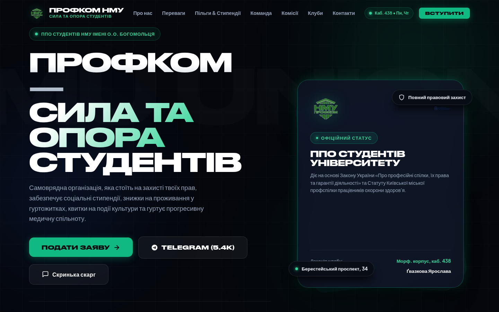
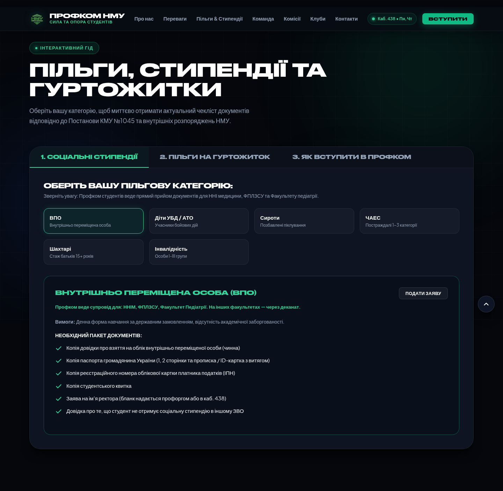
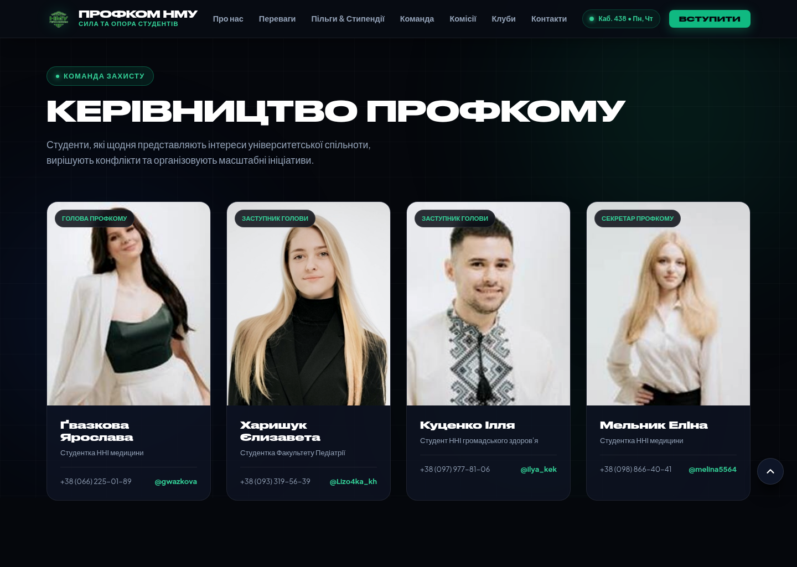
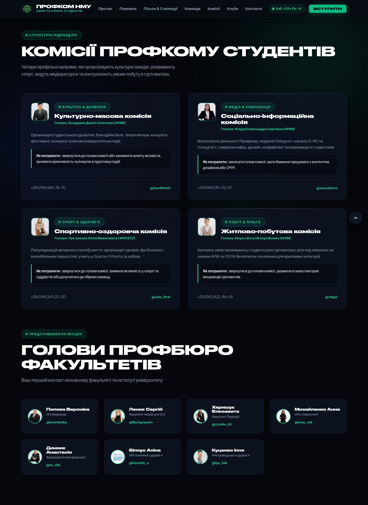
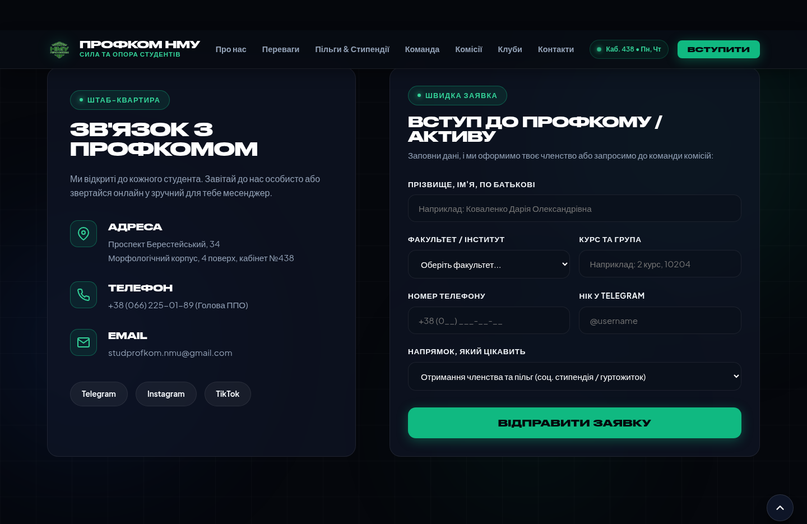
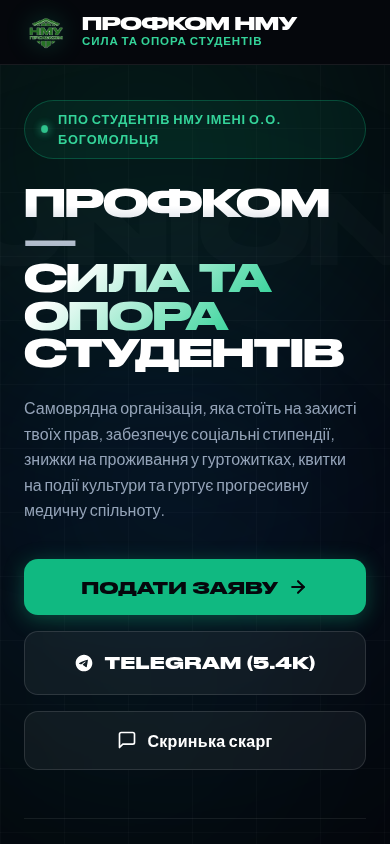

# Профком студентів НМУ імені О.О. Богомольця
### Офіційний веб-портал Первинної профспілкової організації студентів



Сучасний, брендовий веб-портал ППО студентів Національного медичного університету імені О.О. Богомольця з передовою типографікою **Druk Wide Cyr**, інтерактивними інструментами для студентів та темною медичною естетикою (Dark Glassmorphism).

---

## ⚡ Огляд функціоналу та структури

1. **Головний екран (Hero Section)**:
   * Типографіка заголовків на базі фірмового шрифту **Druk Wide Cyr** (повна підтримка української та латинської абеток).
   * 3D-багатошаровий скляний інтерфейс з інформацією про офіційний статус організації та розклад прийому.
   * Швидкі кнопки переходу до офіційного Telegram-каналу (5.4K підписників) та подачі заяви.
2. **Кинетичний рядок (Marquee)**:
   * Динамічний бігучий рядок з ключовими векторами роботи профспілки.
3. **8 ключових переваг члена Профкому**:
   * Правовий захист під час сесій та відрахувань, соціальні стипендії, 49% та 100% знижки на гуртожитки, квитки на події, матеріальна допомога, спорт, молодіжні ініціативи.
   * Інтерактивний ефект підсвічування карток (Cursor Spotlight).
4. **Інтерактивний гід та калькулятор пільг**:
   * **Соціальні стипендії** (Постанова КМУ №1045) — інтерактивний перемикач категорій: ВПО, Діти УБД/АТО, Сироти, ЧАЕС, Шахтарі, Інвалідність з миттєвим формуванням списку необхідних документів.
   * **Пільги на гуртожиток** — умови отримання 100% безкоштовного проживання та 49% знижки для ВПО.
   * **Покроковий вступ до Профкому**.
5. **Команда та керівництво**:
   * Картки голови Профкому (Ґвазкова Ярослава), заступників (Харишук Єлизавета, Куценко Ілля) та секретаря (Мельник Еліна) з прямими контактами в Telegram.
6. **Комісії та Профбюро факультетів**:
   * Культурно-масова, Соціально-інформаційна, Спортивно-оздоровча та Житлово-побутова комісії.
   * 7 голів профбюро факультетів та інститутів НМУ.
7. **Студентські клуби**:
   * NMU Debate Club, Медичне волонтерство, Спортивні збірні, NMU Media Lab, Інтелектуальні ігри, Клуб дозвілля.
8. **Форми та модальні вікна**:
   * Форма онлайн-заявки на вступ.
   * Анонімна скринька довіри для повідомлення про порушення прав студентів.

---

## 📸 Галерея інтерфейсу

| Калькулятор пільг | Керівництво Профкому |
| :---: | :---: |
|  |  |

| Комісії та профбюро | Контакти та форма |
| :---: | :---: |
|  |  |

| Мобільна версія (iPhone 390px) |
| :---: |
|  |

---

## 🛠 Технологічний стек

* **HTML5 Semantic & Accessible**: доступна розмітка з ARIA-атрибутами.
* **Modern CSS3**:
  * CSS Custom Properties (Design Tokens)
  * `@font-face` з оптимізованими форматами `WOFF2`
  * Backdrop Blur, Linear Gradients, Grid & Flexbox
* **Vanilla JavaScript ES6+**:
  * Калькулятор документів по пільгах
  * Анімовані лічильники цифр (IntersectionObserver)
  * Картковий Spotlight-ефект
  * Модальні вікна з клавіатурною навігацією (Escape, Focus trap)
* **Активи та символіка**: офіційні векторні емблеми НМУ та оброблена емблема Профкому.

---

## 🚀 Запуск проєкту локально

```bash
# Клонування репозиторію
git clone https://github.com/brslvdrkchv/NMU-Student-Union.git

cd NMU-Student-Union

# Запуск локального HTTP-сервера (Python)
python3 -m http.server 8080
# або через Node / Vite
npm install
npm run dev
```

Відкрийте в браузері: `http://localhost:8080/`

---

## 📍 Контакти Профкому

* **Адреса**: м. Київ, Берестейський проспект, 34, Морфологічний корпус, 4 поверх, кабінет №438
* **Графік прийому**: Понеділок, Четвер: 15:00 – 18:00
* **Telegram**: [@Profkom_NMU](https://t.me/Profkom_NMU)
* **Email**: studprofkom.nmu@gmail.com
