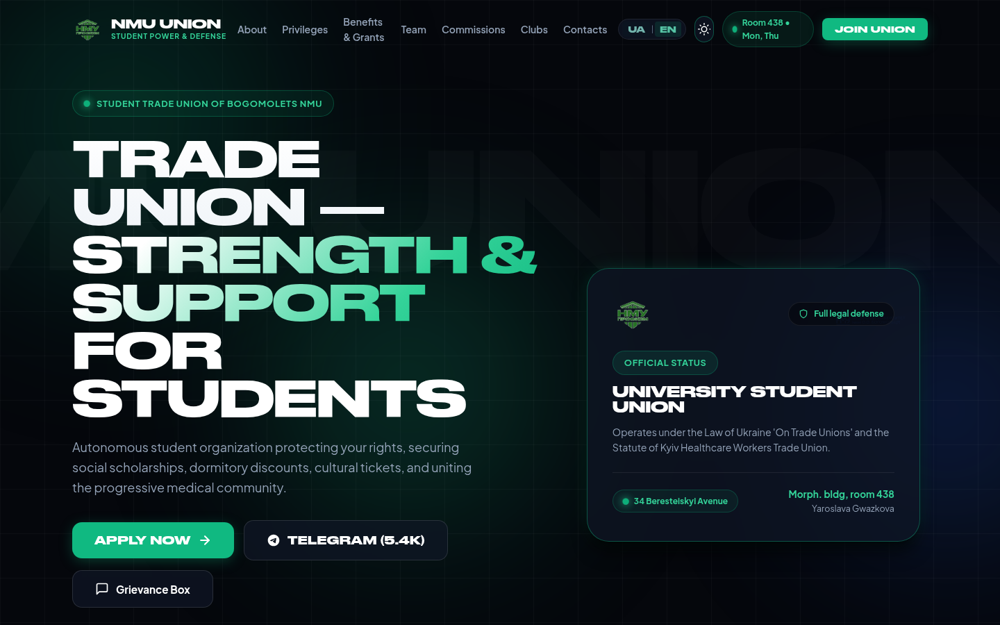
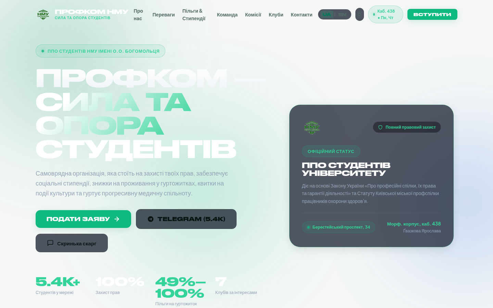
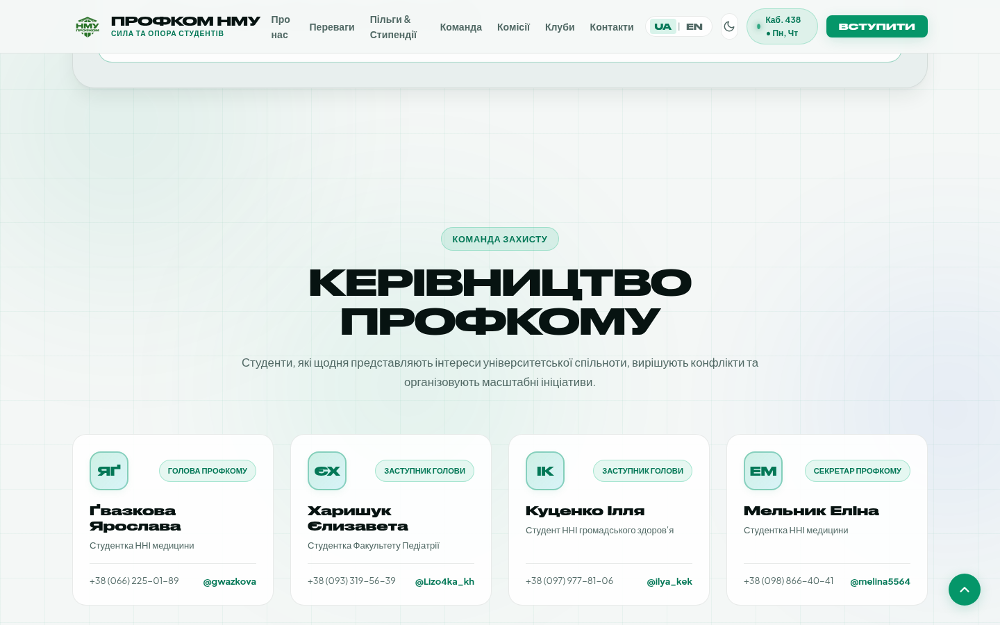
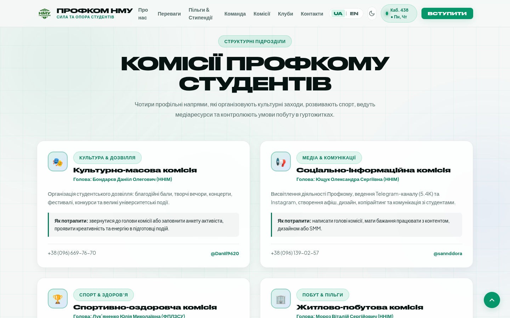
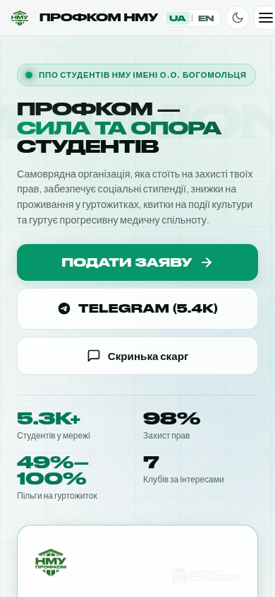
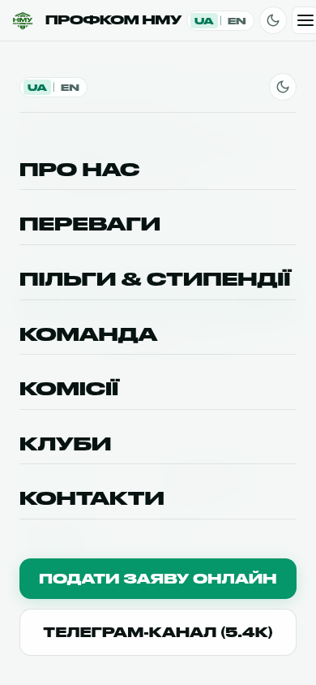

# Профком студентів НМУ імені О.О. Богомольця / NMU Student Union
### Офіційний брендовий веб-портал / Official Web Portal

Сучасний, технологічний веб-портал Первинної профспілкової організації студентів Національного медичного університету імені О.О. Богомольця. 
Розроблений на базі фірмової акцидентної типографіки **Druk Wide Cyr**, підтримує **темну та світлу теми**, **повну двомовність (UA / EN)**, компактні дизайнерські мініатюри та адаптивність для всіх мобільних екранів.

---

## 🌐 Живе посилання на сайт (GitHub Pages)

👉 **[https://brslvdrkchv.github.io/NMU-Student-Union/](https://brslvdrkchv.github.io/NMU-Student-Union/)**

---

## ✨ Що реалізовано

1. **Повна двомовність (UA / EN)**:
   * Миттєве перемикання мов без перезавантаження сторінки (`UA | EN`).
   * Повний переклад усіх блоків, меню, форм, карток та інтерактивного калькулятора стипендій (актуально для іноземних студентів та англомовного відділення НМУ).
2. **Світла та Темна теми (Light & Dark Theme)**:
   * Зручний перемикач теми в шапці сайту та в мобільному меню (`☀️ / 🌙`).
   * Запобігання миготінню теми (FOUC prevention через `<meta name="color-scheme">` та миттєвий скрипт ініціалізації).
   * Автоматичне визначення системної теми користувача та збереження вибору в `localStorage`.
3. **Заміна фотографій на дизайнерські мініатюри**:
   * Замість громіздких фотокарток реалізовано компактні нео-бруталістські аватари-мініатюри керівництва з монограмами в Druk Wide Cyr (`ЯҐ`, `ЄХ`, `ІК`, `ЕМ`).
   * Стилізовані мініатюри комісій (🎭 Культурна, 📢 Медіа, 🏆 Спорт, 🏢 Житлова) та профбюро факультетів.
4. **Виправлена мобільна адаптація**:
   * 100% перевірка на екранах від 360px до 412px (Android) та 390px (iPhone).
   * Повна відсутність горизонтального скролу (`hasOverflow: false`).
   * Компактна шапка з фіксацією, що вміщує логотип, перемикач мов, кнопку теми та гамбургер.
   * Зручне мобільне меню-шторка на весь екран.
5. **Інтерактивні інструменти**:
   * Калькулятор документів на соціальну стипендію за Постановою КМУ №1045 (ВПО, УБД, Сироти, ЧАЕС, Шахтарі, Інвалідність).
   * Гід по отриманню 49% та 100% знижок на університетські гуртожитки.
   * Модальні вікна подачі заявки та анонімної скриньки довіри.

---

## 📸 Галерея інтерфейсу

| Світла тема (Light Mode) | Англійська версія (English UI) |
| :---: | :---: |
|  |  |

| Команда (Мініатюри керівництва) | Комісії (Іконні мініатюри) |
| :---: | :---: |
|  |  |

| Мобільна версія (390px) | Мобільне меню (Drawer) |
| :---: | :---: |
|  |  |

---

## 🛠 Технологічний стек

* **Typography**: Оригінальний локальний шрифт **Druk Wide Cyr** (латиниця та кирилиця з підтримкою `Ґ`, `Є`, `І`, `Ї`) + **Plus Jakarta Sans**.
* **CSS3 Architecture**:
  * CSS Custom Properties з підтримкою `data-theme="light"` та `data-theme="dark"`.
  * Сучасні медіа-запити та clamp-функції.
  * Glassmorphism (Backdrop Filter blur, ambient glow mesh).
* **Vanilla JavaScript ES6+**:
  * i18n модуль локалізації з динамічною підміною контенту без перезавантаження.
  * Theme controller з підтримкою системних налаштувань.
  * Динамічний калькулятор документів.
  * Анімовані лічильники цифр (IntersectionObserver).
  * Клавіатурне управління діалоговими вікнами (Escape, Focus management).

---

## 📍 Контакти Профкому студентів НМУ

* **Адреса**: м. Київ, проспект Берестейський, 34, Морфологічний корпус, 4 поверх, кабінет №438
* **Години прийому**: Понеділок, Четвер: 15:00 – 18:00
* **Telegram**: [@Profkom_NMU](https://t.me/Profkom_NMU)
* **Email**: studprofkom.nmu@gmail.com
